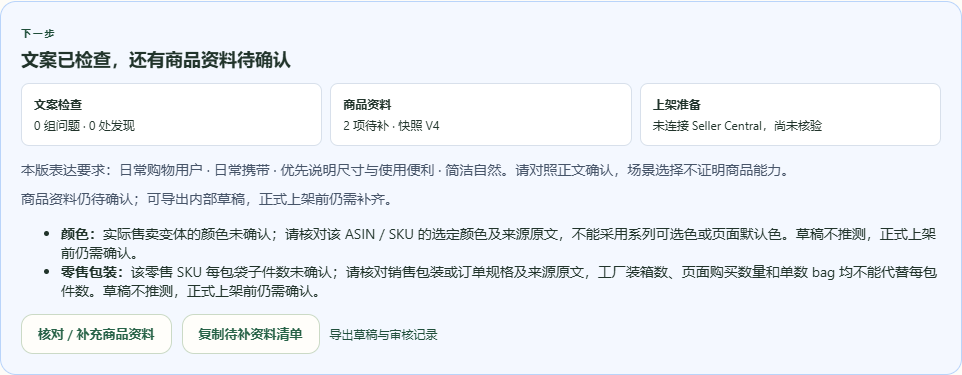
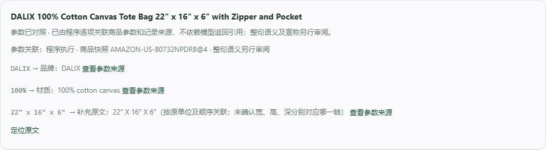

# DALIX 尺寸来源关联修复与真实复检

日期：2026-10-31，Asia/Shanghai。

尺寸的 4 处误报已解决；颜色与零售每包件数仍未知，用户本轮也明确回复“未知”。本次没有补造商品参数或上架状态。

## 原因与修复

商品 `AMAZON-US-B0732NPDRB@4` 的 `dimensions_cm.value` 实际为 `null`，并非旧提示所说的“已填宽、高”。但商品已保存三轴原文 `22" X 16" X 6"`，关联 DALIX 官方链接及 2026-10-24 登记的来源摘录 `22" X 16" X 6"; Outer Pocket; Top Zipper Closure`。审核程序原先先产生“缺少结构化深度”候选，后面的原文匹配无法覆盖它，导致完整照录也被标成缺依据。

现在只有在实际来源记录中找到一致的商品尺寸，且文案数值、原单位和顺序均一致时，才把它关联为“原文尺寸”。不会据此写入厘米尺寸，也不猜哪一轴是宽、高、深。缺来源、变更数值/单位/顺序、附加未确认轴名、可选尺寸，以及包装、纸箱、提手、口袋或印花尺寸继续阻断；已有结构化尺寸时也不能用原文覆盖冲突。参数关联版本升级为 `structured-parameters-v2.6-original-dimension-tuples`。

界面明确显示“按原单位及顺序关联；未确认宽、高、深分别对应哪一轴”。颜色与零售包装的待补说明改成该 ASIN / SKU 需要核对的实际资料，不能拿系列可选色、默认颜色、工厂装箱数或页面购买数量替代。

## 真实来源与未知项

专项复检中实时访问 DALIX 官方页得到 HTTP 429；Amazon ASIN 页虽为 HTTP 200，但返回 Continue shopping 验证内容，没有取得可用商品属性。没有绕过验证或访问限制。尺寸关联采用已登记的真实来源原文，不声称本轮重新独立核验了尺寸。颜色和每包件数没有新依据；用户确认两项未知后，继续保持空值和待补状态。

来源观察及既有出处见 [acceptance.json](acceptance.json)。该记录显示：原 V10 正文不变，商品资料仍为 V4，复检保存 V11，旧版本及全部商品参数保持原样，尺寸问题由 4 处降至 0 处，仍有颜色与零售包装 2 项待补。后续标准浏览器验收保存 V12 复检及 V13 A/B 采用版，均保留这两项未知。0 处文案发现不表示完成上架准备。

## 验收结果

- `npm run build` 通过；保留现有主 bundle 超过 500 KB 提示。
- 8 个相关测试文件共 45 项通过，覆盖尺寸、单位、轴名、原文来源、结构化冲突与包装/口袋用途边界。这些工程检查不替代真实模型验收。
- `node scripts/validate-live-dimension-source.mjs --real-api` 对现有真实 DALIX 文案独立复检，保存 V11，4 处原文尺寸均关联到已有来源，正文与商品参数未改。
- `npm run test:live` 实时读取 W101 官方来源，完成真实生成、修订和补规格复检；见 [standard-live.json](standard-live.json)。
- `npm run test:live:browser` 完成当前真实工作台复检、旧版本保护、证据展示、导出和 A/B 保存/采用；见 [browser-acceptance.json](browser-acceptance.json)。
- 使用现有真实 V13 做只读桌面/390px 手机核对，来源弹窗可打开，原文尺寸的轴名边界和 2 项待补说明可见，无横向溢出；无新增模型请求。见 [ui-acceptance.json](ui-acceptance.json)。

本轮共 14 次真实 DeepSeek 响应、102,378 tokens；5 次 `MODEL_INVALID_JSON` 首次格式失败经既有重试恢复。失败响应未删去，全部实际请求 ID、模型、耗时、用量与错误码来自本机请求台账，见 [model-call-ledger.json](model-call-ledger.json)。账单金额未知。首次专项启动遇本机端口短暂未监听，未发出模型请求；随后恢复服务并完成验收，未使用模拟模型或演示结果。

## 界面证据

完整来源展示见 [03-source-record.png](03-source-record.png)，移动端见 [04-mobile-missing-fields.png](04-mobile-missing-fields.png)。

固定分享文件继续使用 `releases/listing-studio-hackathon-final.zip` 与同名 `.sha256`，本轮标签 `dalix-dimension-source-20261031-working-tree-snapshot`。本机数据库、模型配置、原始响应和缓存不进入交付包；Git bundle 仅包含已提交基线，源文件与清单哈希定义当前工作区快照。
