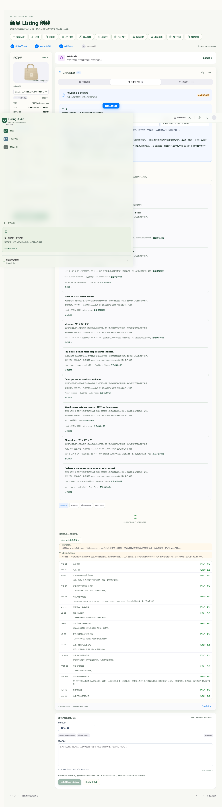

# 既有工作台真实验收（与保温杯演练区分）

既有工作台真实公开商品流程验收；标准为 Westford Mill W101，浏览器操作本机已有真实商品记录。本报告不代表保温杯品类、法规或上架资质验收。无真实商家库存、订单、销售或 Seller Central 数据。

执行日期：2026年11月1日星期日 GMT+8 11:17:17。

- `npm run test:live`：退出码 0。实时读取 Westford Mill W101 官方页面，完成生成与独立审核、改稿与独立审核、补充实时规格后复检，版本 V1–V3 各 0 条文案发现。
- `npm run test:live:browser`：退出码 0。在既有真实记录 `listing-06ebe642-4bf9-4dc7-8316-b6da881a12a0` 上完成 V16 复检、三版 A/B 真实生成、采用后独立复检 V17；实际复检与采用后均 0 条文案发现。
- 浏览器同时检查草稿恢复、陈旧商品版本拒绝、版本历史、证据展示、HTML/TXT/JSON/英文导出、A/B 生成时关闭与导航保护、结果重新打开不重复生成。页面错误为 0（脚本结尾断言）。
- 共 13 次真实响应，93614 tokens；失败 5 次。每次实际请求 ID、模型、耗时、用量、错误字段见 [workbench-acceptance.json](workbench-acceptance.json)。
- 5 次失败均为 `MODEL_INVALID_JSON`：DeepSeek 实际响应正文不符合 JSON 合同；每次均保留为失败，随后另一次真实格式重试恢复。不是 HTTP/API 200 就算验收通过，未回退模拟模型。

API 成功和 0 条文案发现不等于上架通过。实际售卖颜色和零售包装仍未知；保温杯品类法规、食品接触、热性能实测、商家资质及 Seller Central 上架均未在此验收。

| 流程 | 实际请求 ID | 模型 | 耗时 ms | tokens | 结果 |
| --- | --- | --- | ---: | ---: | --- |
| standard_w101 / create | 5b631996-c60f-4e41-8625-acff227fa761 | deepseek-flash | 2228 | 6242 | ok |
| standard_w101 / diagnose | 97fa16a1-14e5-4402-818b-efcc187a5170 | deepseek-flash | 4641 | 7053 | failed / MODEL_INVALID_JSON |
| standard_w101 / diagnose | c86495f9-7277-4c38-9315-5c7b4f3019a4 | deepseek-flash | 3422 | 6831 | ok |
| standard_w101 / revise | 65b027d8-b31b-4e84-825d-b99cb9e686ce | deepseek-flash | 1888 | 7229 | ok |
| standard_w101 / diagnose | e953200b-fbe7-4435-9705-8b9466eb9d15 | deepseek-flash | 3895 | 7023 | failed / MODEL_INVALID_JSON |
| standard_w101 / diagnose | 2d78d461-c9d9-468f-9928-f224fec1d43b | deepseek-flash | 3231 | 6832 | ok |
| standard_w101 / diagnose | 032ca631-f42f-45f6-96f2-ac14bfaec9b9 | deepseek-flash | 4644 | 7138 | failed / MODEL_INVALID_JSON |
| standard_w101 / diagnose | d3b0f31b-c6da-41ee-8142-29b7efcb4d7a | deepseek-flash | 3709 | 6826 | ok |
| browser_existing_real_listing / diagnose | 9aa690cd-fac8-433a-983a-6c2409753a53 | deepseek-flash | 4914 | 9679 | failed / MODEL_INVALID_JSON |
| browser_existing_real_listing / diagnose | a01b34a7-35f5-4031-86f7-104d522a3b49 | deepseek-flash | 2696 | 8973 | ok |
| browser_existing_real_listing / ab_variants | c6b0c765-0779-4d76-b215-2b2ce7ee9fbb | deepseek-flash | 3134 | 1243 | ok |
| browser_existing_real_listing / diagnose | 1b39632f-5b4d-42b6-9e92-a272e3512188 | deepseek-flash | 5010 | 9601 | failed / MODEL_INVALID_JSON |
| browser_existing_real_listing / diagnose | 7e3301c0-aeb0-44d1-a57b-727680b0805c | deepseek-flash | 2779 | 8944 | ok |

所有原始响应、数据库和本机配置保留在本机私有运行目录，交付仅含允许字段的脱敏报告。未打印或复制 API 密钥。

