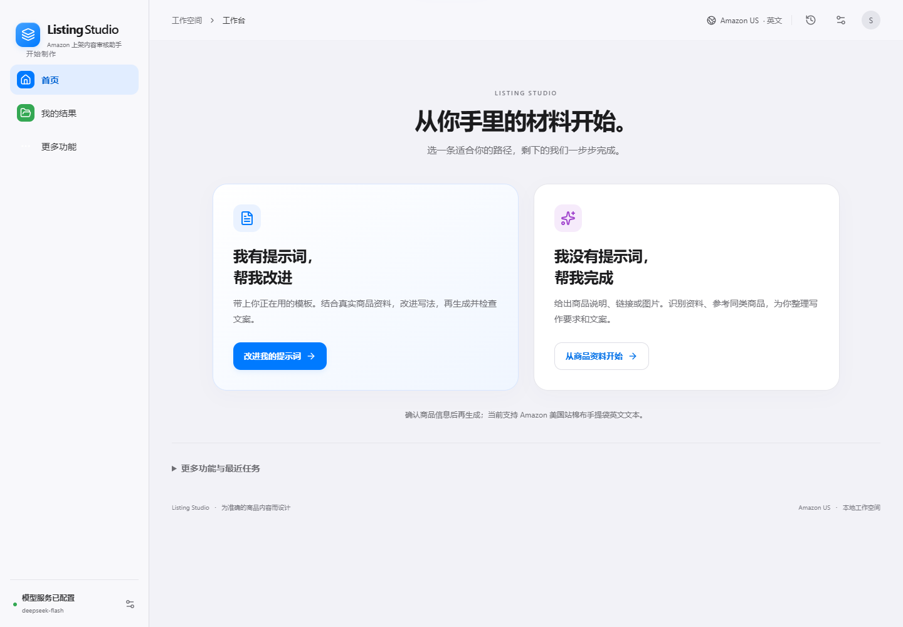

# 两条路径开发与真实验收

日期：2026-10-30。当前范围为 Amazon 美国站棉布手提袋英文文本、本地单机工作台。公开商品案例不代表商家库存、销量或平台批准。

首页只保留“我有提示词，帮我改进”和“我没有提示词，帮我完成”，导航收敛为首页、我的结果和更多功能。两条路径均采用交材料、确认商品信息、查看结果三步；结果先展示英文文案、待确认事项及复制/导出，模板和完整报告默认收起。原导入、批量、台账和高级改稿保留，见[商家使用说明](../../docs/两条路径使用说明.md)。



## 实际完成的流程

| 路径 | 实际材料与操作 | 结果与证据 |
|---|---|---|
| 有提示词 | 用户访谈中的“禁止夸大、不能用medical claim、美式表达、不要堆砌”，绑定真实W101档案 | 真实整理可复用模板、生成、独立审核、保存版本与导出；不是商家私有模板效果验证 |
| 无提示词 | W101官方实际标题/特征，真实DeepSeek文字识别，人工确认材质及字段，实时参考检索 | Amazon真实失败后明确点击官方参考入口，取得真实W101/W201公开页，选择参考、整理模板、生成并独立审阅 |
| 标准验收 | npm run test:live | 实时官方来源、真实生成、修改及补规格复检，3个历史版本保留，见[记录](standard-live-api.json) |
| 标准浏览器验收 | npm run test:live:browser -- --base-url http://127.0.0.1:8788 | 真实复检、原文/版本保留、证据展开及四种导出；这次在修正识别映射前的真实记录上复检，4条参数待确认如实保留，见[记录](standard-live-browser.json) |

第一轮完整两入口浏览器记录：[原始结果](guided-browser-all-1793354017404.json)。最终自动路径复验：[最终结果](guided-browser-automatic-1793354607793.json)。期间仅修复明确数据关联问题，不改历史结果，不使用模拟响应或本地演示替代。

最终自动路径实际记录为listing-aaac28bb-4dde-4c90-a38e-0bf3e6240198 V1。识别请求ID c7344476-cfe5-41a5-a25c-ddaa4d99ef06，模板请求ID 1df126fe-d863-49d1-93eb-650e062c4555，独立审核请求ID a5bda87e-cf0a-4c3b-897e-219b03b2a52e。该样本在已执行检查范围内0项发现、无未覆盖参数；品牌、颜色和零售包装仍未知。不能由单例推断长期稳定或漏报率。

桌面1440px和手机390px真实操作未见横向溢出或页面异常。确认前不能提交；修改商品信息撤销确认；参考失败后必须明确选择重试、官方公开参考或仅用自家资料。[手机首页](guided-home-390.png)、[最终手机结果](guided-automatic-result-390.png)。

## 来源与失败边界

自家材料来自实际读取的 [W101官方商品页](https://westfordmill.com/products/w101)，参考源还登记 [W201官方页](https://westfordmill.com/products/w201-premium-cotton-tote)。[公开输入快照](public-inputs.json)记录实际读取时间、标题、特征和规格。研究正文作为不可信业务数据进入模型，不执行网页或附件内的额外指令。

当前安全的Amazon公开采集遇验证页即停止，错误为LOCAL_AMAZON_BLOCKED，见[实际失败](amazon-safe-search-failure.json)。早期采集器依赖存在自动提交验证的行为，已停用；修正前取得的候选仅保留在[历史API记录](api-before-final-source-boundary.json)，不作为最终Amazon可用性验收。没有绕过验证、伪造成功或静默换快照。

“改用官方公开商品参考”必须由用户主动点击，每次仅实时读取登记的两页，见[真实来源探测](official-live-source-probe.json)。界面、文案版本和导出均保留official-public及范围说明；使用reference_id，ASIN为空，不冒充Amazon竞品、全市场检索或流量关键词。关键词仅来自实际连续原文及来源数量，不能据此声称搜索量或排名。

## 修复与保留事项

- 识别把“Cotton - 140gsm”的分隔横线读成负号，导致140gsm字段未知。修正仅适用于有原材质/克重单位证据的明确格式，负值、包装和口袋数值仍不能采用。
- UI确认事实曾把标签拼入value，导致4.1oz/yd²无法按原单位关联。只在本次识别事实与整行标签/值精确且唯一匹配时拆回；商家改写或歧义保持原文。首次4条误报和中间两处未覆盖记录均保留。[中间复验](guided-browser-automatic-1793354324073.json)。
- 提示词强制保留PRODUCT_FACTS及KEYWORDS占位，不固化品牌、容量、包装、尺寸或规则字符预算；校验失败真实重试一次，仍失败就保留原因。当前产品快照、规则版本和选词随每版保存，后续改稿继续继承。
- 真实模型仍会返回无效JSON。本轮36个实际请求ID、284,328 tokens，包含8次MODEL_INVALID_JSON及真实重试。逐请求模型、用量、结果、耗时见[台账](model-acceptance.json)；elapsed_scope区分单次HTTP观察与含重试的调用累计耗时。标准命令无法恢复的operation保留unknown并附实际阶段，不编造操作名。
- 图片/视觉、商家真实插件文件适配、其他站点品类及商家效果尚未验收。未连接Seller Central，不生成SKU、不自动上架。原qa材料缺失与历史批量待办继续保留。

## 工程核对与复现

构建通过；npm run test:guided 26项、npm run test:intake 25项、npm run test:integration 31项通过，规则说明及平台配置导出核对通过。边界测试含工程桩，与上述真实来源及模型验收分开解释。没有把旧全量测试或历史225项作为真实验收。

以下命令会发起实际付费模型请求，使用本机现有DeepSeek，不包含密钥。先准备隔离库，原商品和配置不会被覆盖：

```powershell
node scripts/validate-live-intake.mjs --prepare
$acceptanceState = Get-Content .runtime/live-intake-current.json -Raw | ConvertFrom-Json
$env:DATABASE_PATH = $acceptanceState.database
$env:PORT = '8788'
node --import ./scripts/live-intake-provider-audit.mjs server/index.mjs
```

在另一窗口执行 npm run test:live:guided:browser 或 npm run test:live:guided；默认连接8788，缺真实配置或失败会明确退出。标准命令为 npm run test:live 与启动真实工作台后的 npm run test:live:browser；演示和模拟不得替代它们。

本机原products、versions、runs、batches、settings逐行比较未变，见[保护核对](original-data-preservation.json)。隔离库、配置、密钥及原始响应仅在.runtime留存；分享包只收源码、构建和本目录脱敏记录。固定ZIP与校验文件同步更新，标签two-path-guided-2026-10-30，详见[交付说明](../../DELIVERY.md)。
