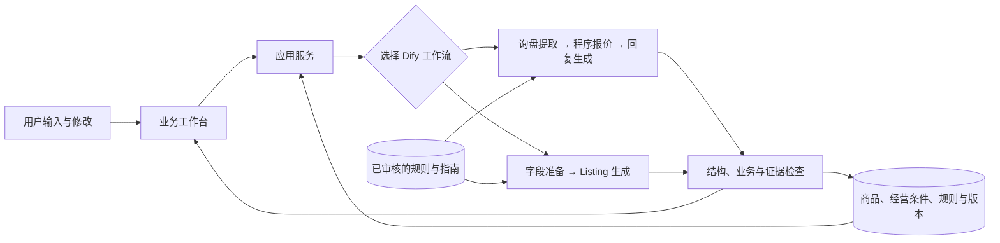

# 出海业务工作台：AI＋外贸黑客松详细方案

> 历史方案：2026-10-21 已按最新要求收敛为 Amazon 单平台。当前开发范围请以 [Amazon Listing 精细化落地方案](Amazon-Listing精细化落地方案.md) 为准。

版本：v1.0｜日期：2026-10-21｜性质：产品与技术方案，尚未实现产品。

约束：10 月 24 日完成功能开发，10 月 25 日 12:00 前交付；本文不安排成员分工。当前没有私有商家数据、指定商品品类或已经验证的客户需求，使用可追溯的公开商品参数与明确标记的演示经营数据。

## 1. 产品决策

**产品暂名：出海业务工作台。**

**一句话定位：帮助小型外贸商家，把同一份可信商品资料，转成不同海外平台需要的业务内容，并在使用前发现信息缺口和规则风险。**

首版服务同时处理批发询盘与零售上架内容的商家，使用者是商家的业务员和运营。软件属于商家端工具；生成的内容分别交给企业采购商和零售消费者。这个用户画像是当前的产品假设，尚未由真实商家使用验证。

核心任务固定为两个：

1. 阿里国际站 RFQ 应答：根据一条采购需求和商品资料，形成针对性的回复、报价草稿和待确认事项。
2. Amazon 美国站 Listing 制作：根据同一商品资料，形成结构化商品页面草稿、规则批注与修改记录。

两个任务共用商品事实、来源和版本；各有输入、表达目的、输出字段和检查方法。TikTok 脚本作为后续扩展，不影响首版完成。

## 2. 要解决的问题与价值

### 2.1 问题描述

商家已经拥有产品，但资料通常分散在商品表、供应商说明和历史沟通中。开展不同平台业务时，需要重复查找资料、整理信息、改写内容，并确认生成内容是否符合事实与平台要求。

本项目选择解决三个问题：

| 问题 | 产品行为 | 可以观察的结果 |
|---|---|---|
| 商品资料需要反复整理，跨岗位容易不一致 | 建立带来源和版本的商品档案，两个工作流共用 | 同一商品的材质、尺寸、容量等字段在不同产出中保持一致 |
| 同一产品在不同平台的表达与信息要求不同 | 分别配置 RFQ 和 Listing 的结构、写作指南与规则 | RFQ 回答采购条件；Listing 展示产品属性与用途，字段明显不同 |
| AI 可能补出没有依据的认证、效果、价格或交期 | 商品事实约束、程序计算、规则校验和人工确认 | 无依据的信息被标为待确认；金额来自计算；风险定位到具体字段 |

这些是待验证的产品假设，不把“提高成交率”“减少多少人力”写成已取得的结果。比赛可测量产出耗时、字段一致性、风险检出情况和人工修改工作量。

### 2.2 使用前后

使用前：读取资料 → 手工整理产品事实 → 根据平台重新组织内容 → 人工核对参数、承诺和规则 → 修改 → 保存。

使用后：确认商品档案 → 选择任务并补充上下文 → 得到结构化草稿及风险 → 对话修改 → 查看变化与依据 → 人工确认后复制或导出。

### 2.3 相比普通聊天工具的具体区别

- 商品事实有独立存储和来源，修改话术不会自动改写产品参数。
- RFQ 与 Listing 使用不同的数据结构和规则配置。
- 单价、总额、数量门槛等由程序处理。
- 每条风险包含位置、原因、依据与建议动作。
- 每次修改保存版本，重新执行检查，能够解释改了什么。

## 3. 对赛题的逐项覆盖

依据：[赛题第二部分“AI＋出海”](https://hcn5szavbjrh.feishu.cn/wiki/H4XzwHiFBih2cskSPK6ckkPrnjb)。以下“实现选择”属于本方案，并非官方指定技术路线。

| 赛题要求 | 本方案实现 | 验收证据 |
|---|---|---|
| 明确业务场景、用户、市场、触发与输出 | 小型外贸商家；RFQ 应答与 Amazon 美国站内容制作 | 两个任务入口、示例输入、对应结果 |
| 至少两种目标语言，或两类角色／场景的本地化业务产出 | 采用“两类角色／场景”路径：业务员的询盘回复与运营的 Listing；首版对外英文，操作与解释中文 | 两类不同用途的业务产出，不能仅凭中英界面计数 |
| 至少两个平台或场景，并做平台风格适配 | 阿里 RFQ 与 Amazon Listing；共用商品事实，各有结构和指南 | 两种结果结构并列展示，解释各自为什么这样写 |
| 至少两轮对话式迭代 | 初稿 V1 后进行两次用户修改，形成 V2、V3 | 修改指令、版本差异、每次重新检查记录 |
| 至少两类校验 | 平台规则检查＋报价／合同条款完整性与一致性检查 | 规则分类、不同类别风险示例；金额检查单独归为业务检查，不用来冒充两类要求 |
| 至少两种反馈方式 | 风险标记＋逐项文本批注；版本差异作为第三种 | 字段标记、原因与建议、修改前后对照 |
| 实际配置能力并调用 | Dify 两个工作流、知识检索、模型调用与程序检查 | 工作流导出、调用编号、实际检索来源与运行日志 |
| 两个相关工作流，稳定的端到端互动 | 两个业务任务使用同一商品档案，均经过理解、生成、检查、反馈 | 相同样例能重复运行；每次保留输入、输出和状态 |
| 解释数据传递和异常处理 | 商品数据、规则数据、模型产出、检查结果分层传递 | 本文架构、接口定义及异常场景演示 |

赛题括号中的阿里、Amazon、TikTok 是平台示例，不应自行扩大为必须同时支持三个。本方案选择两个平台，是为了清晰展示用户强调的平台适配要求。

## 4. 首版范围与完成标准

### 4.1 必须完成

| 模块 | 首版内容 | 完成标准 |
|---|---|---|
| 商品档案 | 两个公开参考产品；手动录入／编辑；字段来源；演示标记 | 可查看事实、单位、未知项和来源；保存新版本 |
| RFQ 应答 | 粘贴询盘、需求提取、指定商品匹配、演示报价、回复草稿、条款检查 | 正常案例与至少一条交期／数量冲突可演示 |
| Amazon Listing | 固定美国站及一个商品类型，生成结构化文案 | 输出符合当前已配置字段与内容规则，不能混入批发报价信息 |
| 风险反馈 | 严重程度、具体字段、依据和处理建议 | 用户能知道哪里有问题，以及如何修正 |
| 对话修改 | 基于上个版本修改、保存 V1/V2/V3、重新校验 | 两次修改后，未被授权改变的商品事实保持一致 |
| 业务输出 | 复制文本、下载结构化 JSON、打印友好报价视图 | 带未确认项的结果只能作为标记清楚的草稿导出 |
| 运行记录 | 输入快照、来源、输出、检查记录、耗时及错误状态 | 可以解释某个结果如何产生 |

### 4.2 核心稳定后增加

第二目标语言、第二市场、少量商品批量处理、自动生成 PDF、TikTok 脚本。图片生成、实时竞品抓取、自动发布、自动发邮件、物流实时报价、复杂账号体系不进入首版验收范围。

### 4.3 功能完成判定

两个工作流可真实调用；两类规则有明确示例；两种反馈可见；初稿后两次修改可重复；关键风险不会被错误标成已解决；项目能按 README 重启；数据与配置能导出。页面美化不能替代这些条件。

## 5. 商品与公开数据方案

### 5.1 为什么选棉布手提袋

没有特定品类时，建议选参数容易核对、既能讨论批量采购也能组织零售内容的棉布手提袋。尺寸、材料、面料克重、容量和提手等差异有助于展示匹配逻辑。选这一品类不代表免除某个国家或平台的商品要求；首版只承诺覆盖已列出的检查范围。

### 5.2 已找到并核验的公开商品事实

| 参考产品 | 材质 | 面料克重 | 尺寸 | 容量 | 提手长度 | 来源 |
|---|---|---|---|---|---|---|
| Westford Mill W101 | 100% 棉 | 140 g/m² | 38 × 42 cm | 10 L | 67 cm | [品牌官方页面](https://westfordmill.com/products/w101) |
| Westford Mill W201 | 100% 棉 | 200 g/m² | 38 × 42 cm | 10 L | 67 cm | [品牌官方页面](https://westfordmill.com/products/w201-premium-cotton-tote) |

两者的公开页面还区分单件重量、装箱数量及包装数量，适合用来验证单位是否混淆。这里只提取完成演示所需的事实及出处；不下载商品图片，不复制整页营销文案。

公开参考商品保留真实品牌和型号。在合成演示目录中使用独立的 DEMO SKU，明确“规格参考公开资料，经营条件为合成样例”。不把虚构报价归到品牌或真实经销商名下。

### 5.3 三类数据分开存储

| 数据层 | 内容 | 来源标识 | 使用限制 |
|---|---|---|---|
| 公开商品事实 | 材质、尺寸、克重、容量、提手等 | public_reference | 可核验的产品资料；并不证明本项目有库存或销售授权 |
| 演示经营条件 | 单价阶梯、起订量、生产周期、付款条件、有效期 | synthetic_demo | 全部在界面、文件和路演中明确标为演示数据 |
| 官方规则与指南 | Amazon 内容要求、阿里 RFQ 写作指导 | official_policy / official_guidance | 记录平台、市场、日期和适用范围；指南不冒充强制规则 |

公开商品页面未提供的批发价格、库存、生产交期、运费、定制费用、证书原件均保留未知。模型不能用零售价格反推供应商成本或批发报价。

### 5.4 本次配套数据文件

- `data-research/public-product-facts.json`：两个参考商品的结构化事实与来源。
- `data-research/demo-business-fixtures.json`：独立的合成经营条件、样例询盘和演示修改指令。
- `data-research/rule-register.json`：初始规则登记表，区分官方规则、官方指南和项目业务规则。

这些文件是后续实现的输入素材；本次尚未导入 Dify，也未实现执行这些规则的程序。

## 6. 工作流 A：阿里国际站 RFQ 应答

### 6.1 输入

选择商品或允许在两个样例商品中匹配；粘贴询盘；选择目标市场和输出语言；填写确认过的商家条件。可以中文输入需求，但对外业务草稿采用目标语言。

询盘提取字段：采购商品、数量、单位、材料／规格、是否定制、目的地、要求的时间及其含义、预算、缺失信息。

区分“20 天内到货”和“20 天生产完成”，并保存客户原句。目的地或运输条件缺失时，不推算到货日期。

### 6.2 处理步骤

1. 根据商品版本取得事实与演示经营条件。
2. 使用模型把询盘提取为结构化需求，用户可以更正。
3. 程序检查规格、数量门槛和条件冲突；字段不足则生成澄清问题。
4. 程序按币种最小单位计算单价和总额；运费或定制费未知时单列待确认。
5. 检索 RFQ 写作指南及相关业务条款，生成针对询盘的回复与报价草稿。
6. 检查报价／合同条款完整性、金额一致性和承诺依据。
7. 返回草稿、风险、待确认问题和来源，保存为一个版本。

阿里官方的[报价指导文章](https://seller.alibaba.com/businessblogs/quality-quotations-win-quality-deals-px7uo467)强调针对采购需求、清楚说明费用及时间条件。该文章发表于 2020 年，在本方案中只作为商务写作指导，不将其写成完整的现行处罚规则或法律效力判断。

### 6.3 输出

- 客户回复：需求理解、匹配产品、明确的报价条件、待确认问题与下一步。
- 报价卡：商品、数量、单位、币种、单价、商品小计、已知费用、未知费用、生产周期、付款条件和报价有效期。
- 内部确认清单：需询问客户／需确认供应能力的事项。
- 风险列表：例如采购量低于起订量、生产周期已经超过要求的到货期限、缺少运输费用。

### 6.4 演示样例

以下经营数据为合成：DEMO-TOTE-140 起订量 1,000 件；1,000–2,999 件单价 USD 1.50；3,000 件起 USD 1.30；生产周期 25 个自然日；运输与定制费用待确认。

买家希望订购 1,000 件，并在 20 天内收货。程序计算商品小计 USD 1,500，同时指出生产周期与到货要求冲突；结果应提出确认或替代方案，不能承诺 20 天送达。

修改一：“数量改为 3,000 件。” → 商品小计更新为 USD 3,900；交期冲突保留。

修改二：“客户接受先确认 25 天生产周期，运输时间和费用另议。” → 记录条件变化，生成修订回复；运输仍为待确认，不把生产周期写成到货周期。

## 7. 工作流 B：Amazon 美国站 Listing 制作

### 7.1 输入

商品版本、目标站点、商品类型、目标语言、销售单位／包装内容、允许强调的用途、品牌信息状态及可选旧稿。

销售单位必须显式确认。例如批发订单的 1,000 件、供应商的每箱 250 件与零售的每包 1 件，是不同概念。公开页面的装箱数量不能直接成为零售包装数量。

### 7.2 处理步骤

1. 读取经过确认的商品事实，移除与零售文案无关的批发报价条件。
2. 根据站点和商品类型选择规则版本，检索对应说明。
3. 生成标题、Item Highlights、商品要点及描述草稿；要点数量是本应用的展示选择，按实际类别要求调整，不宣称所有类别都强制五点。
4. 程序检查长度、必填结构、联系方式／URL、价格及库存信息混入等已配置规则。
5. 模型辅助检查语义、事实支持与本地化表达；没有可引用的依据时标为需复核。
6. 返回字段化编辑界面、风险批注和来源，保存版本。

### 7.3 已核验的官方规则依据

Amazon 美国站[商品详情页规则](https://sellercentral.amazon.com/gp/help/external/G200390640?locale=en-US)要求商品描述准确，并对详情文案中的联系方式、价格、库存等内容作出限制。具体规则需限定到对应字段，不套用于平台独立的售价字段。

[官方标题更新公告](https://sellercentral.amazon.com/seller-forums/discussions/t/145b6d0f-999c-4555-896c-c694bda2e470)规定自 2026-07-27 起非媒体类标题不超过 75 字符、Item Highlights 不超过 125 字符。初始规则针对美国站非媒体样例启用，记录核验时间，不推广成所有地区和品类的永久规则。

### 7.4 展示重点

- RFQ 可以呈现本次询价的商业条件；Listing 文案只呈现适合消费者理解的商品信息。
- 尺寸换算保留原始单位和精度，不能制造更精确的实测数据。
- “100% 棉”不能自动升级为“有机认证”；资料未提供某证明意味着证据缺失，不等于确认产品没有该证明。
- “容量 10 L”不能当作“承重 10 kg”；面料克重不能当作单件重量。
- 草稿可指出用途，但负载、防水、耐洗次数等性能承诺需要相应依据。

### 7.5 输出与修改

输出结构为标题、亮点、要点、描述、内部审阅说明与来源。修改记录保存用户指令、更新字段、未改变事实和新检查结果。

例如先要求简化标题，再要求强调日常通勤，形成 V1/V2/V3。另设一个反例：要求加入有机认证时，系统应提示证据缺失并提出可支持的替代表达，不偷偷修改商品档案。

### 7.6 同一商品如何体现平台适配

| 维度 | 阿里 RFQ | Amazon US Listing |
|---|---|---|
| 阅读者与目的 | 企业采购商；判断供应条件是否匹配、是否继续沟通 | 零售消费者；理解商品属性与用途 |
| 组织方式 | 针对询盘逐项回应，报价表、条件与澄清问题 | 标题、亮点、商品要点与描述 |
| 数量与价格 | 本次采购量、MOQ、价阶、商品小计与费用范围 | 确认后的零售包装；价格使用专门字段，不进入描述文案 |
| 时间 | 区分生产、运输、到货与起算条件 | 产品内容不继承本次批发询盘的交期承诺 |
| 表达 | 简明商务沟通，先回应关键需求，明确下一步 | 清楚说明可核实属性和用途，避免堆砌关键词及无证据宣传 |
| 本地化 | 使用询盘约定的币种和时间表达，保留需确认事项 | 美式英语；必要时附常用计量换算，保留原值和近似标记 |
| 核心检查 | 报价条件完整、前后一致、金额正确 | 字段长度、内容限制、描述准确、包装与事实一致 |

**下面只是预期输出示例，不是模型实际运行结果；价格与经营条件全部来自演示数据。**

RFQ 回复片段：

> For 1,000 plain cotton tote bags, the draft goods price is USD 1.50 per piece, with a goods subtotal of USD 1,500. Shipping, taxes and duties remain to be confirmed. Our demo production term is 25 calendar days after order details are confirmed and the deposit is received, so we cannot confirm arrival within 20 days. Would a later delivery date work for you?

Amazon 标题草稿：

> Cotton Tote Bag with Long Handles, 1 Pack

Amazon 亮点草稿：

> 100% cotton, 140 g/m² fabric; 10 L capacity and 67 cm handles.

其中品牌、颜色等未确认信息仍保留在审阅清单，示例不表示已具备正式上架所需的全部字段。尺寸可写为“approximately 15.0 × 16.5 in (38 × 42 cm)”，这是对原始厘米值的近似换算，不表示重新测量。

这组差异应能在界面中直接看见：切换平台会改变产出结构、相关业务字段和检查方式，而不仅仅切换一段提示词中的平台名称。

## 8. 校验与反馈设计

### 8.1 规则类别

| 类别 | 首版检查 | 判定方式 | 依据 |
|---|---|---|---|
| 平台规则 | Amazon 标题／亮点长度、详情联系方式、商业条件混入、准确描述 | 程序检查＋有来源的语义复核 | 官方平台规则 |
| 报价／合同条款 | 币种、数量、价款、费用范围、生产与运输区分、有效期、付款条件的完整性与一致性 | 程序检查为主 | 项目声明的审阅清单＋当次商家条件，不判定法律效力 |
| 商品事实一致性 | 材质、尺寸、容量、克重、认证等不被无依据修改 | 字段比对＋证据匹配 | 当前商品档案版本 |
| 商家业务规则 | 起订量、价阶、金额一致性 | 确定性代码 | 商家输入；本次使用合成规则 |
| 风格与文化表达 | 目标语言、商务语气、可理解的计量方式、避免刻板表达 | 模型辅助与人工复核 | 场景写作指南；不冒充当地法律 |

官方验收的两个明确类别由前两行覆盖；其他检查补充实用性。两个平台的长度检查仍属于同一类别。

### 8.2 风险输出结构

每条风险包含 `risk_id`、`category`、`severity`、`field_path`、`observed_value`、`reason`、`rule_id`、`source_ids`、`suggested_action`、`origin` 和 `status`。

严重程度使用阻断、待确认、建议；判断来源使用程序、模型辅助或人工。没有依据的“通过”不允许出现在结论中。模型提供的来源 ID 必须能映射到本次实际传入或检索到的资料。

### 8.3 三种可见反馈

1. 字段级风险标记：点击标记定位到标题、交期或条款。
2. 文本批注：说明问题、依据、建议动作。
3. 修改前后对比：显示哪些字段变化，以及旧风险是已解决、仍待确认还是不再适用。

结果状态至少区分“需补资料”“有待确认项”“当前检查通过”。“当前检查通过”仅指已覆盖规则，不表示平台已经审核或商品可无条件上架。

## 9. 产品界面与交互

首版只做三个主要页面，历史记录和来源详情用抽屉展示。

| 页面 | 用户看到什么 | 关键操作 |
|---|---|---|
| 商品资料 | 两个样例、规格字段、来源、缺失信息、演示经营条件 | 选商品、确认资料、编辑并保存新版本 |
| 业务工作台 | 顶部选择 RFQ／Amazon；左侧输入，中间业务结果，右侧风险与来源 | 生成、修改字段、提交修改指令、查看解释 |
| 版本与导出 | V1/V2/V3、字段差异、风险变化、复制与下载 | 比较版本、回看旧稿、复制或导出当前草稿 |

桌面工作台示意：

```text
商品 DEMO-TOTE-140 v1    场景：RFQ / Amazon US    数据：演示
┌──────────────────┬────────────────────────┬─────────────────┐
│ 任务输入与条件    │ 业务产出               │ 检查与依据      │
│ 询盘 / 上架目标   │ 回复＋报价 / Listing   │ 阻断 / 待确认   │
│ 市场、语言        │ 可编辑字段             │ 对应字段与来源  │
│ 商家确认信息      │ 当前版本号             │ 建议处理动作    │
├──────────────────┴────────────────────────┴─────────────────┤
│ 修改指令：数量改为 3000 件                         [更新草稿] │
│ V1 → V2 → V3       [查看差异] [复制] [导出] [运行详情]        │
└────────────────────────────────────────────────────────────┘
```

交互细节：

- 默认加载一个能运行的样例，不要求用户先设置模型和知识库。
- 运行阶段显示“理解需求／生成草稿／检查规则”，不会只显示无限转圈。
- 用户修改字段与对话修改都进入同一个版本流程，不能绕过检查。
- 风险点击后高亮具体字段；来源卡说明它是官方规则、公开参数还是演示条件。
- 修改商品事实必须进入商品档案确认；“把文案写得更高级”不能触发材质、认证或性能升级。
- 导出时把内部风险清单与对客文本分开；尚未确认的商业条件在对客草稿中也保留明确说明。
- 知识检索、模型名称、token 等技术信息放在运行详情；主界面优先呈现业务内容。

## 10. 技术路线

### 10.1 默认组合

**Dify 工作流＋React/Vite/TypeScript 前端＋轻量 Node.js 服务＋SQLite。**

Dify 负责模型调用、知识检索和流程编排；轻量服务负责商品／版本持久化、调用 Dify、输出校验与导出。浏览器不直接持有模型或 Dify API 密钥。前端只维护一套产品界面，不再叠加一套完整 Chatbot 应用。

优先使用能稳定访问的 Dify 实例；如果自托管，固定已验证的发布版本及模型插件版本。不要把部署整套基础设施和修改 Dify 内核变成比赛的主要工作。初始商品仅两条，结构化事实直接读取，规则文档使用 Dify 知识库；无需额外部署独立向量检索平台。

模型只需满足结构化输出、中英理解、业务改写及可接受的响应速度。先通过本方案的样例集实测，再固定一个供应商与模型版本。此处不预设未验证的准确率、响应时间或 API 费用。

### 10.2 数据流



每次请求固定商品版本、经营条件版本和规则版本，形成输入快照。新修改创建新版本，保留父版本 ID。对话历史只帮助理解修改意图，不能取代这些结构化快照。

### 10.3 RFQ 工作流节点

1. 输入节点：商品事实、经营条件、原始询盘、上版结构化结果、修改指令。
2. 需求提取节点：模型返回数量、规格、时间条件、目的地和原文依据；不明确字段返回 `null`。
3. 代码节点：校验数量与 MOQ，按价阶计算商品小计，判断已知时间冲突，建立不可被模型改写的报价对象。
4. 知识检索节点：检索 RFQ 写作指南与已配置的条款审阅清单，返回可识别的规则／来源 ID。
5. 回复生成节点：依据需求、确定的报价对象和实际检索结果生成英文回复，以及中文内部说明。
6. 检查与输出：输出报价对象、回复、条款缺口和引用；应用服务核对字段与引用 ID，并把结果保存为版本。

报价表直接渲染代码节点的结果，避免让模型重新计算。回复中的金额、数量、日期等必须与该对象一致；发现不一致时提示修正，不能静默显示两个报价。

价阶计算采用整数最小币值，例如 USD 1.30 存为 130 cents；本样例只覆盖单币种、整件数量与未税商品小计。未知运输费不能记为 0，总额未确定时只显示“商品小计”。

### 10.4 Listing 工作流节点

1. 输入节点：商品事实、Amazon US 场景、销售包装、品牌信息状态、旧稿及修改指令。
2. 条件检查：销售单位、必需的商品信息缺失时先请求确认；不继承 RFQ 的采购数量和价格。
3. 知识检索节点：取 Amazon 对应范围的规则及写作指南，记录实际使用来源。
4. 生成节点：返回标题、Item Highlights、要点、描述和逐项事实引用。
5. 应用服务检查：JSON 结构、长度、禁止混入的信息、商品事实与来源有效性；语义问题由模型辅助提示。
6. 输出：结构化 Listing、风险、修改建议和版本信息。

两个工作流均接收“上版结果＋当前修改指令”，以支持至少两次修改。不要依赖一个越来越长的聊天窗口来维持商品事实。

### 10.5 模型与程序的职责

| 任务 | 执行者 | 原因 |
|---|---|---|
| 理解询盘与修改意图 | 模型，必要时用户确认 | 输入是自然语言，可能有歧义 |
| 价阶、金额、MOQ、确定的时间冲突 | 程序 | 同样输入需要得到同样结果 |
| 英文业务表达、用途组织、措辞调整 | 模型 | 需要语言能力和场景适配 |
| 标题长度、字段结构、来源 ID 是否存在 | 程序 | 可直接判断、便于复现 |
| 认证与性能宣称是否有支持 | 字段证据检查＋模型辅助 | 不能仅凭模型记忆判断 |
| 条款缺失与前后矛盾 | 结构检查＋语义复核 | 缺字段和不一致表达需要分别处理 |
| 最终采用对客草稿 | 用户 | 不确定条件需要业务确认 |

提供给模型的商品资料、采购原文和检索内容均作为数据处理，其中出现的指令不应覆盖系统的输出格式、来源约束或金额规则。

## 11. 数据结构与接口约定

以下是实现约定，不是已上线接口。

### 11.1 核心对象

| 对象 | 最少字段 |
|---|---|
| 商品版本 `ProductVersion` | ID、版本、参考商品、规格、单位、字段来源、未知项、演示标识 |
| 经营条件 `BusinessTerms` | SKU、版本、币种、MOQ、价阶、生产周期、起算条件、付款条件、有效期、未知费用 |
| 规则 `Rule` | ID、版本、类别、平台／市场／品类范围、依据类型、来源、核验日期、生效日期、检查方法 |
| 任务与产出 `ArtifactVersion` | 任务 ID、场景、父版本、商品／规则版本、输入快照、业务内容、风险、引用、状态 |
| 运行 `Run` | 运行 ID、调用状态、工作流 ID、实际调用编号、开始／结束时间、错误、实际检索来源 |

不要把所有内容塞进一段 Markdown。业务字段用于渲染和检查；文本只是回复或描述字段的一部分。来源 ID 必须映射到真实存储的来源记录。

### 11.2 建议接口

| 接口 | 用途 |
|---|---|
| `GET /api/products` | 商品列表、当前版本与缺失信息 |
| `GET /api/products/:id` | 商品事实、经营条件与来源 |
| `POST /api/products/:id/versions` | 用户确认后保存新商品版本 |
| `POST /api/tasks` | 创建 RFQ 或 Listing 任务并触发首次生成 |
| `POST /api/tasks/:id/revisions` | 提交修改指令或字段变更，生成新版本 |
| `GET /api/tasks/:id` | 读取当前状态与各版本 |
| `GET /api/runs/:id` | 读取运行进度、错误与调用信息 |
| `GET /api/artifacts/:versionId/export` | 导出当前版本 JSON 或打印友好内容 |

发起生成后返回运行 ID，界面查询状态；重复点击生成需禁用或使用请求标识去重。首版不必为两条工作流额外引入任务队列系统。

输出信封示意：

```json
{
  "task_id": "task-demo-001",
  "artifact_version": 2,
  "parent_version": 1,
  "workflow": "alibaba_rfq",
  "product_version": "DEMO-TOTE-140@1",
  "business_terms_version": "DEMO-TERMS-140@1",
  "rule_set_version": "2026-10-21.v1",
  "run_id": "run-demo-002",
  "is_demo": true,
  "status": "needs_confirmation",
  "content": {},
  "risks": [],
  "source_ids": [],
  "changes": []
}
```

实际运行时填写真实返回内容；示意 ID 不可伪装成真实模型调用编号。生成失败的运行也保留记录，但不创建一个显示“检查通过”的产出。

### 11.3 知识库组织

按“平台＋市场＋用途”分文档：Amazon US 标题规则、Amazon US 详情页内容规则、阿里 RFQ 写作指南、项目报价条款审阅清单。每篇文档带来源链接、核验时间和规则 ID。

结构化规则登记表负责长度和适用范围等确定判断；知识库负责解释与写作依据。两者使用同一规则 ID，避免程序检查 75 字符、知识库还引用旧 200 字符规则。

公开产品数据进入商品表，合成价格进入经营条件表；都不与平台规则混成一个无来源的“大知识库”。当前规则数量很少，人工审核的清晰资料比大量抓取更有价值。

## 12. 开源复用的具体取舍

已有仓库核验记录见同目录 `github-reuse-shortlist.md`。核验包含仓库、许可、部分代码、测试／CI 信息；尚未本机安装运行。此处只保留与最终方案有关的复用点。

| 项目 | 本方案取用 | 仍需自己完成 |
|---|---|---|
| [Dify](https://github.com/langgenius/dify) | 工作流、模型节点、知识检索、代码节点与 DSL 导出 | 两个业务工作流、数据、规则与业务界面 |
| [Dify 官方多平台教程](https://docs.dify.ai/en/quick-start) | 资料输入、平台选择、结构化内容输出的搭建方式 | 把模型自行判断风格改为已审核资料；加入 RFQ 报价、检查、版本 |
| [Amazon 官方 Listings 示例](https://github.com/amzn/selling-partner-api-samples/tree/main/use-cases/listings) | 参考字段校验和定位错误的设计，必要时提取独立函数 | 实际内容规则、模型生成和本地业务数据；不接完整 SP-API |
| [Distill AI 报价组件](https://github.com/Distill-AI/distill-ai/blob/dev/src/modules/pricing/quote-pricing.service.ts) | 参考确定性价阶与金额处理逻辑 | 简化成当前样例需要的实现；不迁移整套 CRM |

Dify 是基于 Apache 2.0 的修改版许可，含附加条件，第三方声明应照实记录；Amazon 示例为 MIT-0；Distill AI 为 MIT。实际复制文件时，保存其适用许可与来源，依赖版本固定到所用发布版或提交。

Distill AI 社区规模较小，只有局部代码与测试可供参考，不能凭它有报价功能就把完整系统当成熟底座。Dify 教程也不是已经适配外贸的一键成品。

若 Dify 路线在已有环境中不可用，可用 [Vercel Chatbot](https://github.com/vercel/chatbot) 替换整条 AI 应用实现路线。它不属于本方案同时安装的依赖；切换后仍必须保留这里的数据、规则、版本与验收约定。

## 13. 异常与降级

| 异常 | 对用户的表现 | 系统处理 |
|---|---|---|
| 询盘数量或时间含义不明 | 标出待确认字段，可继续生成澄清回复 | 不计算猜测的报价或到货承诺 |
| 资料缺失或来源冲突 | 显示缺少什么、冲突在哪里 | 保留冲突，不擅自选一个“看起来合理”的值 |
| 找不到适用规则／检索失败 | 显示规则覆盖不足 | 可提供带标记草稿，禁止输出“当前检查通过” |
| 模型超时或接口失败 | 保留用户输入，显示失败与重试 | 有界重试；记录真实错误，不用旧结果冒充新生成 |
| 模型 JSON 无效 | 显示生成结果格式错误 | 校验后允许一次修复；仍失败则终止该运行 |
| 引用 ID 不存在 | 相应结论标为依据无效 | 不生成假链接，不把未知来源作为检查证据 |
| 商品档案在运行中变更 | 提示结果基于旧版本 | 保留原输入快照，用户决定重新生成 |
| 用户修改请求与事实冲突 | 解释冲突并建议可支持写法 | 不改写档案、不补造认证 |
| 现场网络不稳定 | 明确显示实时运行失败或历史示例 | 可打开此前真实运行的结果及日志，清楚标注历史时间 |

任何历史样例或固定 fixture 都不能充当赛题要求的实际模型调用。现场应有真实调用能力，并准备可查看的历史记录帮助解释异常。

## 14. 验收用例与可测指标

### 14.1 必测用例

| 编号 | 输入／操作 | 预期行为 |
|---|---|---|
| A01 | 同一商品分别运行 RFQ 与 Listing | 两种业务结构，使用相同商品版本与事实 |
| A02 | RFQ 订购 1,000 件 | 单价 USD 1.50，商品小计 USD 1,500；未明费用单列 |
| A03 | 数量修改为 3,000 件 | 单价 USD 1.30，小计 USD 3,900，保存 V2；其他未变事实一致 |
| A04 | 数量 999 件 | 显示低于 MOQ，不能用正常价阶给出可执行承诺 |
| A05 | 生产周期 25 天，要求 20 天到货 | 标记时间冲突，回复提出澄清，不承诺按期到达 |
| A06 | 第二次修改为接受 25 天生产、运输另议 | 保存 V3；旧交期冲突按新条件更新，运输不确定性仍保留 |
| A07 | 运费或定制费未知 | 显示待确认；商品小计不命名为含税到门总价 |
| A08 | 付款比例合计不为 100%，或报价缺有效期 | 标记具体条款问题，并给出应确认的内容 |
| A09 | Amazon 标题 75／76 字符、亮点 125／126 字符 | 边界判断正确，包含空格；对应字段显示规则依据 |
| A10 | Listing 中加入邮箱、URL 或“仅售 USD 1.30” | 标出文案字段问题，独立售价字段不受该文案规则误伤 |
| A11 | 参考页面装箱量 250；演示零售包为 1 件 | Listing 使用零售包，不能写成 250 件一包 |
| A12 | 要求加入“有机认证”“承重 10 kg” | 发现当前资料不能支持；不把 10 L 或纯棉当证明 |
| A13 | 改为 Amazon UK 或未配置商品类型 | 提示范围未覆盖，不套用 US 规则给出通过结论 |
| A14 | 修改标题后又修改用途描述 | Listing 也可形成 V1/V2/V3，事实、来源和每轮检查保留 |
| A15 | 规则检索为空、无效引用、接口失败 | 失败与不确定性可见，不显示虚假的完整通过 |
| A16 | 按 README 重启并读取任务 | 商品、版本、风险和配置可恢复，两个工作流仍可调用 |

A08 的付款比例是本项目对所配置分期方案的完整性检查，不宣称所有贸易交易都必须采用相同付款比例或方式。

### 14.2 指标只记录实际测量

- 功能完成：上表每项记录通过／失败及运行链接；不能用一条成功样例代替所有情况。
- 事实一致性：检查生成字段与输入快照是否一致；无证据认证、性能、价格或交期承诺作为严重错误。
- 风险检出：预置已知问题与干净样例，分别记录检出与误报，展示具体用例，不外推总体准确率。
- 交互耗时：记录首稿及两次修改耗时；可将常规单次生成 30 秒以内作为体验目标，但以实测为准。
- 人工价值：邀请体验者完成同一任务，记录资料查找、修改次数和用时；没有实际对照就不宣称节省百分比。
- 成本：记录模型实际 token／调用量，根据所用供应商当时价格核算；不预设未核验的单次费用。

功能冻结标准是关键用例通过、真实调用稳定和交付可重启，目标在 10 月 24 日达到。剩余时间用于演示材料与回归检查；本文不安排人员分工或逐日任务表。

## 15. 三分钟演示方案

用一个连续案例串起两个工作流，避免分别介绍两个没有关系的聊天机器人。

| 时间 | 展示内容 | 要证明的价值 |
|---|---|---|
| 0:00–0:20 | 说明商家同时面对询盘与上架；打开同一商品档案 | 用户是商家，资料可以共用 |
| 0:20–1:05 | 输入 1,000 件／20 天到货询盘；展示回复、报价与交期冲突 | 理解需求、程序计算、发现不能承诺的条件 |
| 1:05–1:35 | 数量改 3,000，再改为接受生产周期；展示 V1/V2/V3 | 两次对话修改，金额与风险随条件正确更新 |
| 1:35–2:15 | 切换 Amazon US，使用同一商品生成 Listing；展示字段与规则反馈 | 平台适配体现在目的、结构和检查内容 |
| 2:15–2:40 | 点开一条风险和来源，展示无证据认证的处理及修改前后对照 | 依据可查，反馈能指导行动 |
| 2:40–3:00 | 简图说明数据传递、实际调用与最终草稿导出 | 完整、可重复的业务闭环 |

该脚本需要彩排计时。如果实际模型耗时超过预算，可把部分环节用明确标记的历史真实运行结果说明，并保留现场真实互动。不要通过固定输出假装实时调用。

路演材料建议包含：目标用户与问题、商品事实及来源、两个工作流、一次风险与修改、技术及配置、实际效果与范围。海报使用同一案例和两种结果对照，读者应能一眼看懂“商品资料如何变成可审阅的业务内容”。

## 16. 交付清单与边界

### 16.1 赛题交付

- 可编译、可运行的完整工程及 README：安装、启动、环境变量、示例数据、运行两个工作流的方法。
- 两个 Dify 工作流配置导出，以及知识库资料、导入说明和模型绑定步骤；不携带密钥。
- 第三方组件声明：实际使用的仓库、版本／提交、许可证及改动范围。
- 验收记录与示例输入、历史真实运行记录；标明合成经营数据。
- 最终源码 Tag：`hackathon-final`。
- 0.8 × 1.8 m 项目海报。
- 三分钟 PPT 或 HTML 演示文件。

### 16.2 当前产物状态

本次完成的是详细方案和三份结构化资料文件。尚未开发网页、部署 Dify、导入知识库、执行产品用例、生成最终海报或路演文件。JSON 资料可作为下一步导入与实现的起点，但不能当作已完成应用。

### 16.3 仍需用真实使用验证的假设

1. 同时处理 B2B 询盘与零售平台内容的小商家，是否把这两项任务视为值得集中处理的痛点。
2. 给出字段来源、条款缺口和版本变化，是否实际减少人工复核负担。
3. 规则检查的粒度是否适合业务人员，是否出现过多误报。

首版不承诺全品类、全国家或全平台合规，不具备真实库存、物流报价或自动发布能力。报价与 Listing 都是供商家确认的草稿。后续扩展优先来自真实使用反馈，而不是继续增加平台数量。

最终产品判断标准：同一份商品资料进入两个不同业务场景，产生可用的草稿；错误与缺口可解释；修改有记录；关键事实不会随措辞变化而漂移。

